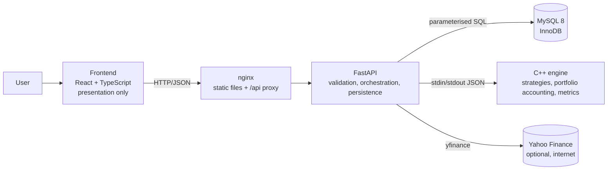

# Architecture

## Components and responsibilities



| Component | Responsible for | Deliberately NOT responsible for |
|---|---|---|
| `frontend/src/pages`, `components` | Rendering, forms, client-side validation hints, charts | Any financial calculation (every number shown comes from the API) |
| `frontend/src/api` | One typed client for the REST API; consistent error handling | UI state |
| `backend/app/api/routers` | HTTP shape, status codes, query-parameter validation | Business logic, SQL |
| `backend/app/api/schemas.py` | Request validation (pydantic): ranges, types, unknown fields rejected | |
| `backend/app/services/candle_validation.py` | Strict OHLCV validation for CSV and provider data | Storage |
| `backend/app/services/` | Orchestration: load candles → call engine → build/persist/export responses | SQL text, HTTP |
| `backend/app/repositories/` | **All SQL** (always parameterised), transactions, DB error mapping | Rules of trading |
| `backend/app/integrations/engine_client.py` | Spawning the engine, timeouts, error translation | |
| `engine/` (C++) | Indicators, strategy signals, order execution, portfolio accounting, metrics | HTTP, SQL, files other than a CSV/JSON request |
| `database/schema.sql` | Integrity rules (keys, CHECKs, trigger), views, procedure | Trading logic |

## Data flow of one backtest

```
User presses "Run backtest"
 → React validates the form (lib/validation.ts) and POSTs /api/v1/backtests/run
 → FastAPI/pydantic validates the body (ranges, types, unknown fields)           [api/schemas.py]
 → repository loads the candles for the instrument + period from MySQL           [repository.get_candles]
 → services builds the engine request and runs `engine` as a subprocess          [integrations/engine_client.py]
      engine: CandleSeries validation → Strategy.prepare/signalAt → Backtester loop
              → Broker (fills, fees, slippage) → Portfolio (cash, positions, trades)
              → MetricsCalculator → JSON
 → services shapes the response (trades + open trade, equity + benchmark, indicators)
 → React renders cards, charts, tables from that response only
"Save" = same request to POST /api/v1/backtests → the run is repeated (the engine is deterministic)
         and written in ONE transaction to 9 tables; the saved result is identical to the preview
         (verified by tests).
```

## Why a C++ engine behind a small Python API?

* The OOP syllabus is C++-specific (destructors, virtual destructors, friend functions, operator overloading, copy constructors, templates, STL). The simulation is where object-oriented design is natural, so that is the part written in C++.
* HTTP, validation, SQL and Yahoo access are much quicker and safer to write in Python; they carry no OOP-syllabus weight.
* **Interface:** the engine is an executable: JSON request on stdin, JSON response on stdout (`docs/engine.md`). Simple to test (the engine has 51 unit tests and is also cross-checked against an independent Python implementation), no ABI/pybind build problems on Windows, and the crash of a run cannot take down the API (timeouts, exit codes handled in `engine_client.py`).
* Cost: one process start per run (a few milliseconds) and JSON encoding of candles; irrelevant for daily data.
* No microservices: three containers (database, API, web server) is the minimum for this stack.

## Strategy catalogue: single source of truth

`engine --list-strategies` prints every strategy with its parameter limits. On start-up the API copies that into `strategy_types` / `strategy_param_specs`, and the UI builds its forms from the database. Adding a strategy means writing one C++ class and registering it in `StrategyFactory`; no other file lists strategies.

## Error handling

Every API error has the same body: `{"error": {"code", "message", "details"}}`. Validation problems are 422, missing things 404, duplicates / in-use 409, database down 503, engine missing 503, anything unexpected a generic 500. Stack traces and SQL never reach the client (they go to the server log). The UI shows server messages inline and as toasts, and explains network failures in plain words.

## Security notes

* Parameterised SQL everywhere; the only dynamic SQL fragments (sort column, direction) come from whitelists.
* The API's MySQL account can `SELECT/INSERT/UPDATE/DELETE/EXECUTE` but not `DROP/ALTER/CREATE`; a second account is read-only.
* Secrets only in `.env` (git-ignored); `.env.example` holds placeholders.
* CSV exports neutralise spreadsheet formula injection (cells starting with `= + - @`).
* nginx adds `X-Content-Type-Options`, `X-Frame-Options`, `Referrer-Policy` and a restrictive CSP. Host ports are bound to `127.0.0.1`.
* There is no authentication (single-user local tool). Do not expose the ports to a network.
