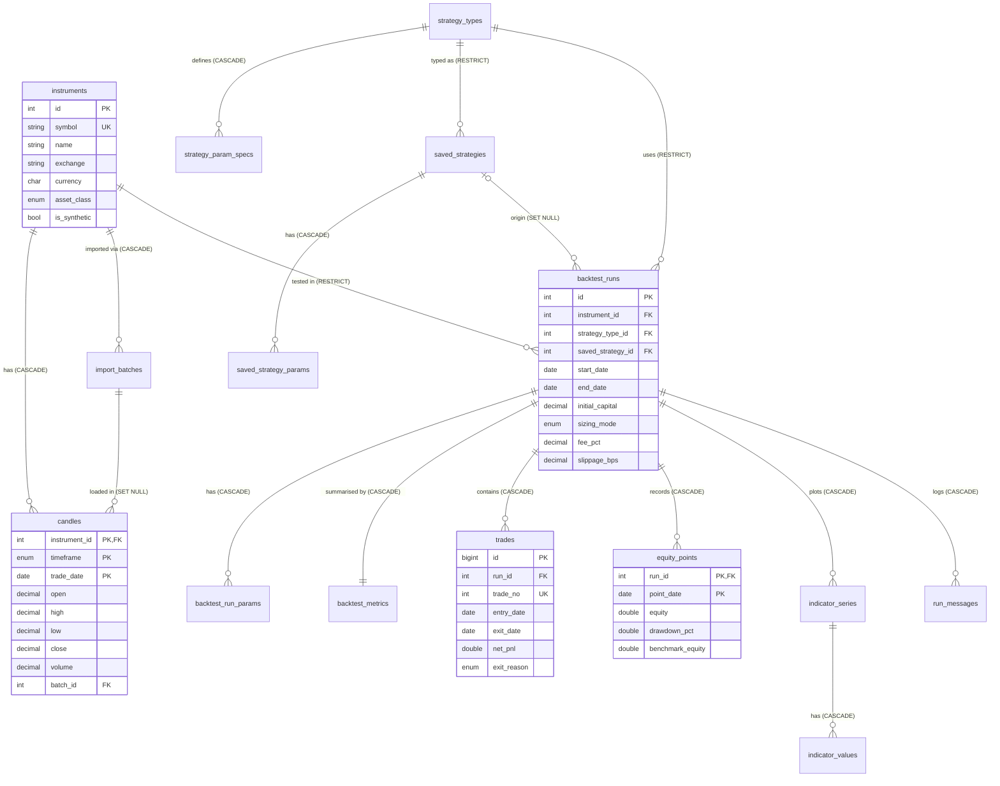

# Database design (MySQL 8, InnoDB)

Source of truth: [`database/schema.sql`](../database/schema.sql). View the ER diagram with VS Code's Markdown preview plus the *Markdown Preview Mermaid Support* extension (GitHub renders it natively).

## ER diagram

Entities, attributes, relationships and cardinalities: every `||--o{` is one-to-many; `backtest_runs ||--|| backtest_metrics` is one-to-one (shared primary key); there are no many-to-many relationships (instrument ↔ strategy is resolved through `backtest_runs`, which is the associative entity carrying the attributes of the combination).

## Tables (15) and views (2)

| Table | Purpose | Key | Notable constraints |
|---|---|---|---|
| `instruments` | tradable symbol | `id`; `UNIQUE(symbol)` | `CHECK(TRIM(symbol) <> '')`; `is_synthetic` marks demo data |
| `import_batches` | audit of each CSV / provider import | `id` | FK → instruments (CASCADE) |
| `candles` | daily OHLCV | **composite PK** `(instrument_id, timeframe, trade_date)` | CHECK prices > 0, volume ≥ 0, `high ≥ low,open,close`, `low ≤ open,close`; trigger blocks future dates; the PK makes duplicates impossible |
| `strategy_types` / `strategy_param_specs` | strategy catalogue synced from the engine | `id`, `UNIQUE(type_key)` / `(type, param_key)` | |
| `saved_strategies` / `saved_strategy_params` | reusable parameter sets | `id`, `UNIQUE(name)` / `(id, param_key)` | |
| `backtest_runs` | one saved run + its configuration | `id` | CHECK `end ≥ start`, capital > 0, fee 0..100; FKs RESTRICT / SET NULL |
| `backtest_run_params` | strategy parameters of the run | `(run_id, param_key)` | |
| `backtest_metrics` | 1:1 result summary | `run_id` (= FK) | CHECK `winning+losing+breakeven = closed_trades`, `max_drawdown ≥ 0` |
| `trades` | ledger | `id`; `UNIQUE(run_id, trade_no)` | CHECK `quantity > 0`, `exit_date ≥ entry_date` |
| `equity_points` | equity, cash, drawdown, benchmark per day | `(run_id, point_date)` | CHECK `drawdown_pct ≤ 0` |
| `indicator_series` / `indicator_values` | chart series | `id`, `UNIQUE(run_id, name)` / `(series_id, point_date)` | |
| `run_messages` | warnings and rejected orders | `id` | |

Views: `v_run_summary` (runs ⋈ instruments ⋈ strategy types ⋈ metrics, used by the History page), `v_trade_detail`.

## Deletion behaviour

| Parent → child | Rule | Why |
|---|---|---|
| instrument → candles, import batches | CASCADE | prices make no sense without their instrument |
| run → params, metrics, trades, equity, indicators, messages | CASCADE | results belong to the run |
| instrument / strategy type → runs | **RESTRICT** | cannot delete something that has saved results by accident (the API answers 409) |
| saved strategy → runs | SET NULL | runs survive, the link is cleared |
| import batch → candles | SET NULL | candles survive an audit-row deletion |

## Normalisation

Notation: `X → Y` = functional dependency.

* **instruments**: `id → everything`, `symbol → everything` (two candidate keys). Every determinant is a candidate key ⇒ **BCNF**.
* **candles**: `(instrument_id, timeframe, trade_date) → open, high, low, close, volume, batch_id`. Only the key determines anything ⇒ **BCNF**.
* **backtest_runs**: `id → all columns`. The strategy is stored as the FK `strategy_type_id` instead of `type_key, name` (which would add the transitive FD `strategy_type_id → type_key, name`) ⇒ **3NF/BCNF**.
* **trades**: `(run_id, trade_no)` and `id` are candidate keys. The instrument is **not** copied into `trades`; it is reached through `run_id` (copying it would create the transitive FD `run_id → instrument_id`). ⇒ **BCNF** apart from the deliberate derived columns below.
* **Strategy parameters** are rows `(owner_id, param_key) → param_value` instead of a JSON blob or one column per parameter: values stay atomic (**1NF**) and a new strategy needs no schema change.
* **Decomposition example (2NF/3NF).** A first design `indicator_points(run_id, series_name, panel, point_date, value)` has key `(run_id, series_name, point_date)` but the FD `(run_id, series_name) → panel`: a **partial dependency** (violates 2NF) and redundancy (the panel is repeated for every date). Decomposed losslessly into `indicator_series(id, run_id, name, panel)` and `indicator_values(series_id, point_date, value)`. The join on `series_id` reconstructs the original and every FD is preserved inside one table.

### Deliberate denormalisation (and why)

| Column(s) | Redundancy | Reason | Control |
|---|---|---|---|
| `trades.gross_pnl, net_pnl, return_pct, holding_days` | derivable from prices, quantity, fees, dates | stored exactly as the engine computed them so exports and screens match to the last digit; sortable/filterable in SQL | `sp_verify_run_integrity` re-adds trade P&L and compares it with the stored metrics; CHECKs on dates/quantity |
| `backtest_metrics.*` | aggregates of trades / equity | a saved result is an immutable **snapshot** of one engine run; recomputing would require the engine and the original data | same procedure |
| `backtest_metrics.notes` (JSON) | text explanations keyed by metric | display-only, never queried by key; a child table would add nothing | |
| `equity_points.benchmark_equity` | has the same key as the strategy equity | one row per run + date; a separate table would only add a join | |

## Relational algebra for three typical queries

1. Runs of a given strategy on an instrument, with their return:
   `π symbol, run_id, total_return (σ strategy_type='sma_crossover' ∧ symbol='SYNTH-TREND' (backtest_runs ⋈ instruments ⋈ strategy_types ⋈ backtest_metrics))`
2. Instruments that have no saved backtest: `π id, symbol (instruments) − π id, symbol (instruments ⋈ backtest_runs)`
3. Winning trades of run 7: `σ run_id=7 ∧ net_pnl>0 (trades)`

(Equivalent SQL for all of these, plus joins, aggregates, sub-queries and `EXPLAIN`, is in [`sql-demos.sql`](academic/sql-demos.sql).)

## Indexes and query optimisation

* Every FK column is the leading column of an index (InnoDB requirement/benefit): `candles` PK range scans by `(instrument_id, timeframe, trade_date)`, `uq_trades_run_no`, `idx_trades_run_entry`, `idx_trades_run_pnl`, `idx_runs_instrument_created`, `idx_runs_type`, `idx_runs_created`.
* `test_queries_use_indexes` asserts with `EXPLAIN` that the candle date-range query uses `PRIMARY` with access type `range` and that the run listing uses `idx_runs_instrument_created`. (Tiny tables may be scanned instead of using an index; the test checks availability for those.)
* Sorting for the History/Trades endpoints uses whitelisted columns so `ORDER BY` cannot be injected.

## Transactions and ACID

* **Atomicity**: `repositories.runs.save_run` writes to up to 9 tables inside one transaction (`db.transaction()`: commit on success, rollback on any exception). `test_save_is_atomic_all_or_nothing` forces a CHECK violation on the trades insert after the run, params and metrics rows were already written and proves nothing remains.
* **Consistency**: PK/FK/UNIQUE/CHECK/trigger rules above; invalid data is rejected by Python validation first and by the database as the last line of defence.
* **Isolation**: InnoDB default `REPEATABLE READ` (snapshot reads, shown by `scripts/demo_concurrency.py` and `test_repeatable_read_snapshot_and_no_dirty_reads`).
* **Durability**: committed rows are in InnoDB's redo log and the data files; in Docker they live in the `db_data` volume and survive `docker compose down` and container restarts (not `down -v`).

## Concurrency, locking and deadlocks

* `SELECT … FOR UPDATE` (row locks) prevents lost updates: 8 threads × 15 increments end at exactly 120 (`test_select_for_update_prevents_lost_updates`).
* `test_deadlock_is_detected_and_one_transaction_is_rolled_back` and `python -m scripts.demo_concurrency` build the classic cycle (T1 locks A then B, T2 locks B then A). InnoDB detects it immediately, rolls back one victim (error 1213) and lets the other commit.
* Concurrent imports of the same candles from four sessions end with exactly one row per date (`test_concurrent_imports_never_create_duplicates`).
* REPEATABLE READ is **not** full serialisability (it allows phantoms for some patterns); `SET TRANSACTION ISOLATION LEVEL SERIALIZABLE` is available when strict serialisability is needed. The application does not need it because its writes are inserts of new rows and single-row updates.

## Stored function, procedure with cursor, triggers

* `fn_return_pct(initial, final)`: `DETERMINISTIC NO SQL`, returns `NULL` instead of dividing by zero; used by `v_run_summary`.
* `sp_verify_run_integrity(run_id, OUT consistent, OUT message)`: opens a **cursor** over the closed trades of a run, sums their net P&L and compares count and sum with `backtest_metrics`. Tests: consistent → TRUE; after tampering with one trade → FALSE with a mismatch message; unknown run → "run not found". (The cursor loop is deliberate: a plain `SUM()` would be shorter, but this is the place the syllabus' cursor concept is genuinely applicable: an audit that walks rows one by one.)
* `trg_candles_bi` / `trg_candles_bu`: reject candles dated more than one day in the future. A CHECK cannot do this because `UTC_DATE()` is non-deterministic, which is the reason a trigger is used.

## Database security (DCL)

* `database/02_security.sh` creates `pbe_app` (`SELECT, INSERT, UPDATE, DELETE, EXECUTE` on the application schema only) and `pbe_readonly` (`SELECT`). Passwords come from environment variables.
* Tests `test_least_privilege_accounts` and the Docker script check that `DROP TABLE`, `ALTER`, `CREATE USER` are denied to the API account (error 1142) and any write is denied to the read-only account.
* `test_sql_injection_attempts_are_inert`: an injection string in a filter is bound as a value; in a symbol it is rejected by validation; in a name it is stored as plain text and every table is still there.
* The container publishes MySQL only on `127.0.0.1`.

## NoSQL and distributed databases

Out of scope for the implementation. Explanation for the viva: the data is relational with strong integrity needs (money, ledger, FKs), so a relational store is the right choice; a document store would suit the indicator series (large, schema-less arrays) but would lose cross-table constraints; distribution (replication, sharding) is unnecessary for a single-user local tool.
